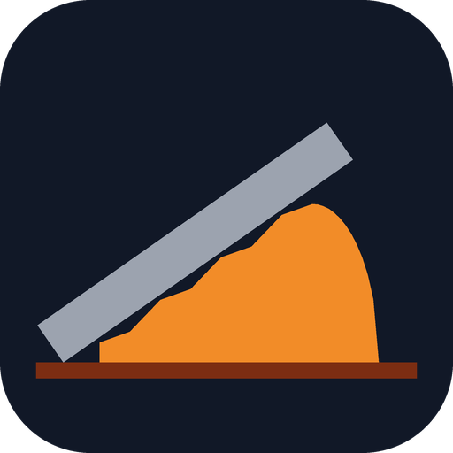
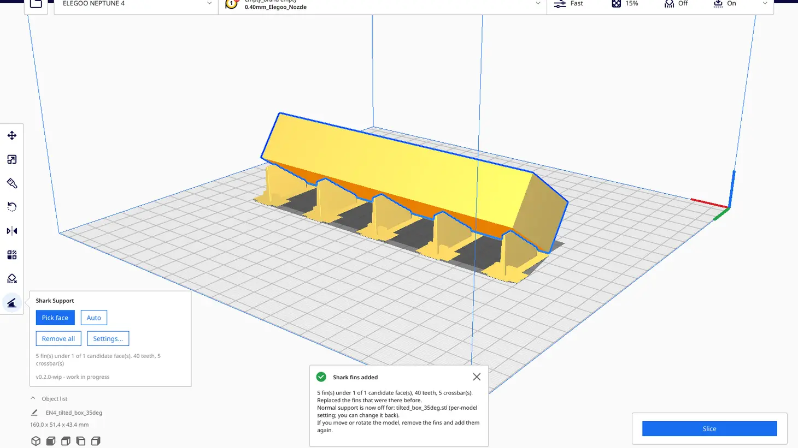
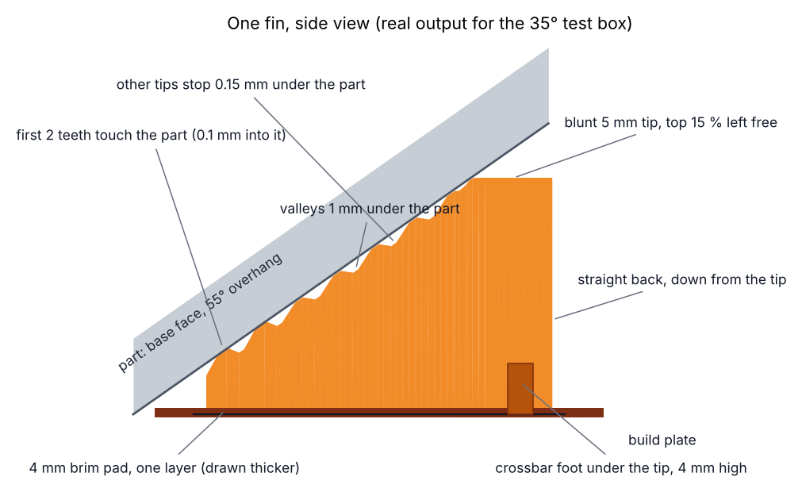
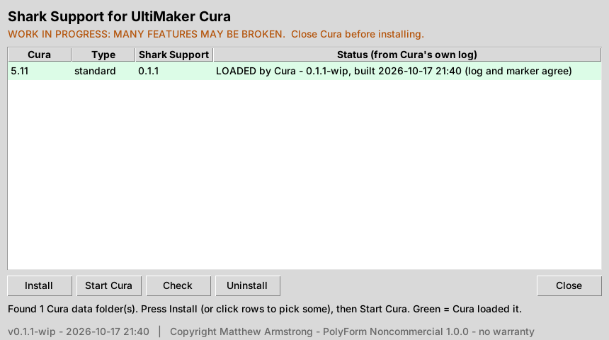
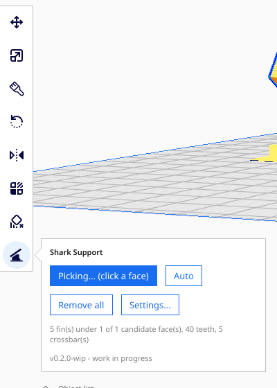
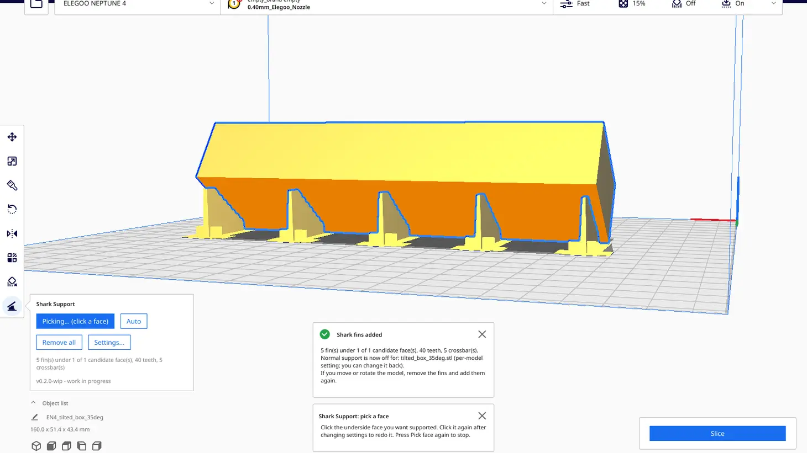
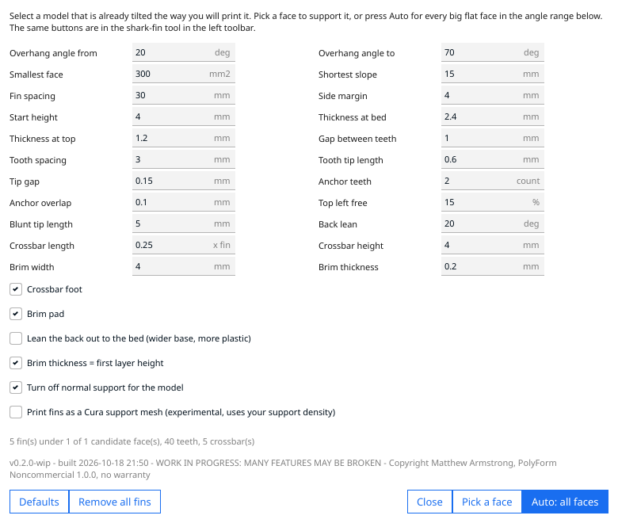
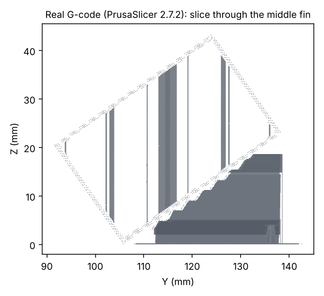
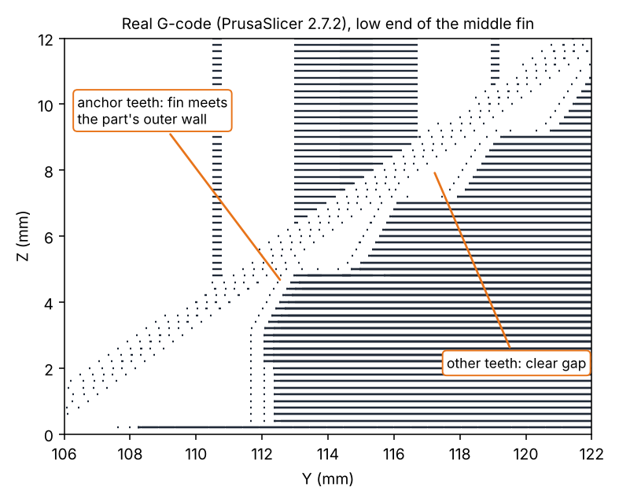

# **WORK IN PROGRESS: MANY FEATURES MAY BE BROKEN** (proof of concept, 0.2.1-wip)



# Shark Support for UltiMaker Cura

**Source-available · Non-commercial.** Copyright Matthew Armstrong. Licensed under the
[PolyForm Noncommercial License 1.0.0](LICENSE.md). No warranty, no liability: use at your own risk.

Shark Support adds thin **shark-fin supports** under big, flat, tilted faces. The typical case: you print a long
box tilted onto one long edge so it is strong along its length. Its base becomes a long 30–55° overhang that is
fine in theory but sags or curls over that length. Shark Support puts a row of fins under it:

- each fin is a thin vertical plate that follows the slope of the part, **stops at 85 % of its height** (the part
  bridges the last bit), has a **blunt 5 mm flat top** (no tiny, slow top layers) and a **straight back** down to
  the bed
- it **only touches the part at small teeth**, a dotted line of points every 3 mm that snaps off cleanly, starting
  right at the fin's low end. The **first two teeth really touch** (0.1 mm into the part) to hold the start of the
  overhang; the rest stop 0.15 mm short
- a **crossbar foot** under the tip (¼ of the fin's length, 4 mm high) and a **4 mm one-layer brim pad** keep tall
  fins standing
- in Cura it is a **button in the left toolbar**: **pick the face** you want supported with the mouse, or press
  **Auto** for every big tilted flat face, and **Remove all** to clear them



*Real screenshot: the plugin running inside Cura (5.15 development source, see [Testing](#what-was-tested)), with
fins under the 35° test box and the Shark Support panel open from its toolbar button.*



## Install (double-click)

1. Download and unzip this repository (green **Code** button, **Download ZIP**), or the release.
2. **Close Cura.**
3. Double-click the launcher for your computer:
   - Linux: **`Install-Linux.sh`** (in the file manager choose *Run*; if it opens in a text editor, right-click,
     *Properties*, *Permissions*, tick *Allow executing*)
   - Windows: **`Install-Windows.bat`**
   - Mac: **`Install-Mac.command`** (first time: right-click, *Open*, because it is not signed)
4. In the window press **Install**, then **Start Cura**. The row turns **green** when Cura's own log shows the plugin
   loaded.



**Other way:** drag `SharkSupport-0.2.1-wip.curapackage` (from the release page) onto the Cura window, then restart
Cura. That is Cura's own installer.

**No window?** If Python's tkinter is missing the launcher says so and falls back to text mode. On Linux Mint:
`sudo apt install python3-tk`. Text mode by hand: `python3 install.py --cli` (and `--check`, `--uninstall`).

Needs: UltiMaker Cura 5.0 or newer (plugin SDK 8) and Python 3.8+ for the installer. The plugin itself uses only
what Cura ships (numpy, PyQt6).

## Use it

1. Load your model and **tilt it the way you will print it** (Rotate tool, *Lay flat*, etc.).
2. Select it, then click the **shark-fin button** at the bottom of the left toolbar (under move, scale, rotate,
   mirror, per-model settings and support blocker). Its panel opens:

   

   - **Pick face**, then **click the underside face** that needs support. Fins appear under that one face. Pick
     more faces the same way; picking a face again replaces its fins (handy after changing settings). Press the
     button again to stop picking. Turn the view so you can see the underside (a low side view works).
   - **Auto**: fins under every big tilted flat face of the selected model(s), replacing their earlier fins.
   - **Remove all**: removes every Shark fin object.
   - **Settings...**: the numbers below.
3. A message says how many fins were made. New objects called *Shark fins (your model...)* appear.
4. Slice and print as usual. Normal support for that model is switched **off** (a per-model setting) so Cura does
   not add its own supports under the same face. You can change that in the settings.

The same actions are in the menu **Extensions > Shark Support**. If you move or rotate the model afterwards, use
**Remove all** and add the fins again: they are a separate object and do not follow the model.



### Settings (Settings... in the panel, or Extensions > Shark Support > Settings...)



| Setting | Default | What it does |
|---|---|---|
| Overhang angle from / to | 20° / 70° | *Auto* puts fins under faces in this range (Cura's angles: 0° = wall, 90° = ceiling). A face you pick gets fins whatever its angle, as long as it faces down |
| Smallest face / Shortest slope | 300 mm² / 15 mm | *Auto* leaves smaller faces alone (picked faces ignore this) |
| Fin spacing / Side margin | 30 mm / 4 mm | Distance between fins across the face, and from its sides |
| Start height | 4 mm | Fins start where the face is this high (low down it needs no help) |
| Thickness at bed / at top | 2.4 / 1.2 mm | Fins taper; with a 0.4 mm nozzle that is 6 lines at the bed, 3 at the top |
| Gap between teeth | 1 mm | The fin edge stays this far under the part except at the teeth |
| Tooth spacing / tip length | 3 / 0.6 mm | The contact points. The first tooth starts at the fin's low end, the last sits at the tall end |
| Tip gap | 0.15 mm | All teeth except the anchors stop this far under the part. Smaller = stronger contact, harder removal |
| Anchor teeth / overlap | 2 / 0.1 mm | The first teeth from the low end reach this far *into* the part so they bond slightly and hold the start of the overhang. 0 turns it off |
| Top left free | 15 % | The fin stops this far below the top of the face; the part bridges the rest. 0 runs it to the top |
| Blunt tip length | 5 mm | The fin's flat top. No layer of the fin is shorter than this, so the printer never slows down for tiny top moves |
| Back lean | 20° | Only with *Lean the back out* on |
| Crossbar length / height | 0.25 × fin / 4 mm | The foot across the fin under its tip (a second one in the middle for fins over 100 mm) |
| Brim width / thickness | 4 mm / first layer | One-layer pad around each fin and crossbar |
| Lean the back out to the bed | off | The back slopes out 20° instead of going straight down: wider base, but more plastic and time (test box: 1.97 m and 42 min instead of 1.68 m and 40 min). The command line also offers round and concave backs |
| Print fins as a Cura support mesh | off | Experimental: Cura then prints them with your support pattern and density |

**Extensions > Shark Support > Run self-check** builds a test box in memory, runs the plugin's own code against it
(including face picking and the toolbar button),
and shows PASS/FAIL per check (also saved to `shark_support_selfcheck.txt` in your temp folder). Run it once after
installing.

## Without Cura (PrusaSlicer, OrcaSlicer, anything)

The geometry code needs only numpy, so there is a command line tool:

```
python3 shark_cli.py part.stl                   # writes part_fins.stl
python3 shark_cli.py part.stl --spacing 25 --merged part_with_fins.stl
python3 shark_cli.py part.stl --back slope       # back leaning out instead of straight down
python3 shark_cli.py --help                     # every setting
```

The STL must already be oriented for printing (Z up, sitting on the bed). Import the fins STL as a second part at
the same position (PrusaSlicer: *Add part*; or slice the `--merged` file). The repository has examples in
[`examples/`](examples/).



*Real G-code: the merged test box sliced by PrusaSlicer 2.7.2 on the command line, showing every extrusion within
0.5 mm of the middle fin. The fin is solid, touches the part only at the teeth, stops below the top of the face
with a flat top, and goes straight down at the back.*

## What exists and what does not

| Exists (0.2.1-wip) | Does not exist yet |
|---|---|
| Fins under flat tilted faces: picked with the mouse, or found automatically | Fins under curved or organic surfaces (it needs flat faces) |
| Fins cut at 85 %, blunt flat top, straight back, teeth every 3 mm, 2 anchor teeth, crossbar, brim pad | Painting exactly where on a face fins go |
| Cura toolbar button with panel, menu, settings dialog, self-check, undo | Fins that follow the model when it is moved |
| Installer that checks Cura's log; `.curapackage` | Live preview while editing settings |
| Command line tool for any slicer | PrusaSlicer / OrcaSlicer plugin (they have no Python plugin API) |
| Experimental "Cura support mesh" mode | A real print test (see below) |

## What was tested

Be aware of exactly what has and has not been tried:

- **Geometry:** 22 automatic tests (`python3 tests/test_core.py`): closed outward meshes, fins never reach into the
  part (only the anchor teeth reach in, exactly 0.1 mm; with anchors off every tip is 0.15 mm below it), boxes tilted 35° and 45°, turned on the bed, standing on a corner,
  the 85 % cut and 5 mm flat top, picking a face (and refusing a top face or a miss), triangle-soup input, spacing, long fins, no fins on a plain cube. A 196,000-triangle mesh took about 2 s on the
  development machine (not timed on a 7th-gen Core i3).
- **Inside Cura:** Cura could not be downloaded in the build sandbox, so it was run **from Cura's and Uranium's
  source (5.15 development branch, plugin SDK 8.13)** under a virtual display, with stand-ins only for Cura's C++
  parts. There the plugin loaded, its **toolbar button** appeared and opened its panel, **a real mouse click
  (sent with xdotool) on the box's underside made fins for that face**, picking it again replaced them, *Auto*
  replaced those with automatic fins with the right per-object settings, the menu and dialog opened, the self-check passed, support-mesh mode and *Remove all fins* worked, and Cura's package
  manager listed it as installed, both after the installer and after Cura's own `.curapackage` route. **Slicing in
  Cura was not tested** (the slicing engine is one of the C++ parts that could not run).
- **Slicing:** the fins were sliced for real with **PrusaSlicer 2.7.2** (command line), picture above. For the
  test box the fins take 1.68 m of filament and about 40 minutes on their own (PrusaSlicer defaults, 0.2 mm
  layers); the 0.1.2 fins, which ran to the top with a sharp tip, took 1.74 m and about 43 minutes. The zoom below shows the anchor teeth meeting the part's outer wall in the G-code while the other
  teeth leave a gap.

  
- **Not tested:** a real print, Cura 5.0–5.10 releases (face picking uses a different path there, written to
  match Cura 5.0's own support blocker but not run), Windows and Mac (launchers and installer), Flatpak Cura.

## Troubleshooting

| Problem | Fix |
|---|---|
| "No fins were made" (Auto) | The face is outside the angle range or too small. Pick it by hand instead, or widen *Overhang angle from/to*, lower *Shortest slope* or *Smallest face*. Curved faces are not supported yet. |
| Clicking does nothing in Pick mode | The first click on a model only selects it; click the face again. The click must land on the selected model's surface. |
| "That face does not face downwards" | You clicked the top or a side. Turn the view lower to see the underside and click that. |
| Shark button is greyed out | Select a model first: Cura's toolbar buttons only work with a selection. |
| Fins appear somewhere else | You moved the model after adding them. *Remove all fins*, then add again. |
| Fins get pushed away from the model | Turn off Cura *Preferences > General > Ensure models are kept apart*. Do not use *Arrange All* after adding fins. |
| Fins fused to the part | Set *Anchor teeth* to 1 or 0, raise *Tip gap* (e.g. 0.25) or lower *Tooth tip length*. |
| Low end of the overhang still lifts | Raise *Anchor teeth* to 3 or *Anchor overlap* to 0.15, or lower *Start height* to 2 mm. |
| Fins wobble or fall over | Raise *Thickness at bed*, *Crossbar length* or *Brim width*; lower *Fin spacing*. |
| Installer row stays yellow | Start Cura once with the plugin installed, then press *Check*. Red means Cura logged an error: please open an issue with `cura.log`. |
| Not in Cura's plugin list | Cura was open while installing and overwrote its package list on exit. Close Cura, press *Install* again. |
| Window does not open on Linux | `sudo apt install python3-tk`, or use `python3 install.py --cli`. |

## Known limitations

- Flat faces only. A curved underside is ignored.
- Fins and part are separate objects: move them together or re-add the fins.
- Where a tooth tip meets a shallow face, the tip and the part's outline are less than one line width apart in the
  same layer, so even the non-anchor teeth may bond lightly. How hard the anchors and the other teeth hold has not
  been print-tested. See [DESIGN_NOTES.md](DESIGN_NOTES.md).
- Large meshes are processed on Cura's main thread: Cura pauses for a few seconds on very big models.

## Research paper

**[Fin-ally Supported: Shark-fin supports for long, flat, tilted overhangs](paper/paper.md)** (version 1.0, first
published 19 October 2026) · [PDF](paper/fin-ally-supported-v1.0.pdf)

Everything behind this plugin written up: the problem, what already exists (including a live patent on "fine point"
supports and how this differs), the method in enough detail to rebuild it, every mistake made on the way, the
numbers, a test plan, and a defensive disclosure of the method and its variations, dedicated to the public so
nobody can patent them. It is published on its own at
[The-Dorkknight/fin-ally-supported](https://github.com/The-Dorkknight/fin-ally-supported); `paper/` is a copy that
travels with the plugin. Text and figures: CC BY-SA 4.0. Infant sharks do, do, do support prints well.

**How to cite:** Armstrong, M. (2026). *Fin-ally Supported: Shark-fin supports for long, flat, tilted overhangs. A
hobbyist's field guide and a defensive publication.* Version 1.0, 19 October 2026.
https://github.com/The-Dorkknight/fin-ally-supported

## More

- [HOW_IT_WORKS.md](HOW_IT_WORKS.md): what the plugin reads, changes and never touches
- [DESIGN_NOTES.md](DESIGN_NOTES.md): research notes, decisions, measurements, ideas
- [paper/](paper/): the research paper (Markdown and PDF)
- [CHANGELOG.md](CHANGELOG.md) · [CONTRIBUTING.md](CONTRIBUTING.md) · [SECURITY.md](SECURITY.md) · [THIRD_PARTY.md](THIRD_PARTY.md)

Not affiliated with or endorsed by UltiMaker. "Cura" and "UltiMaker" are names of their owners.
